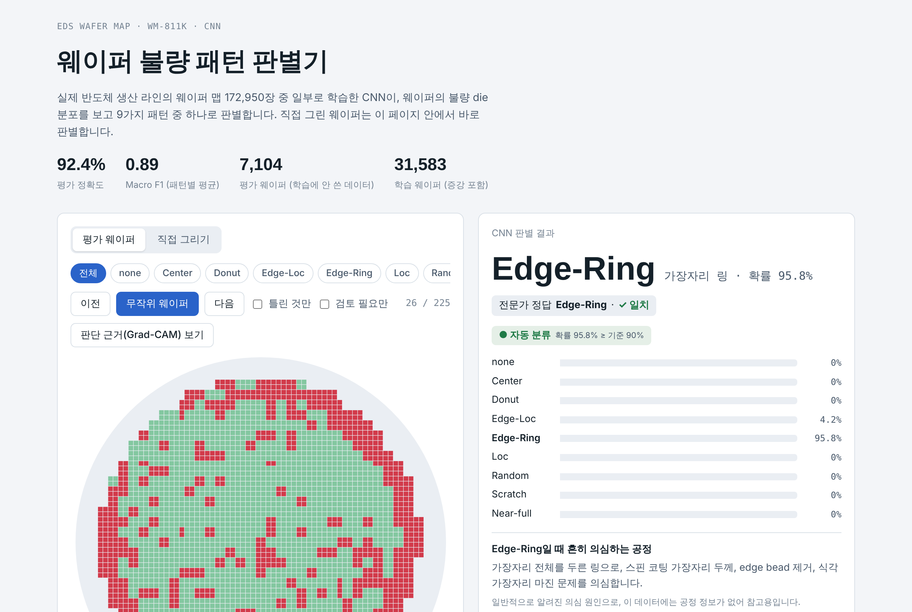
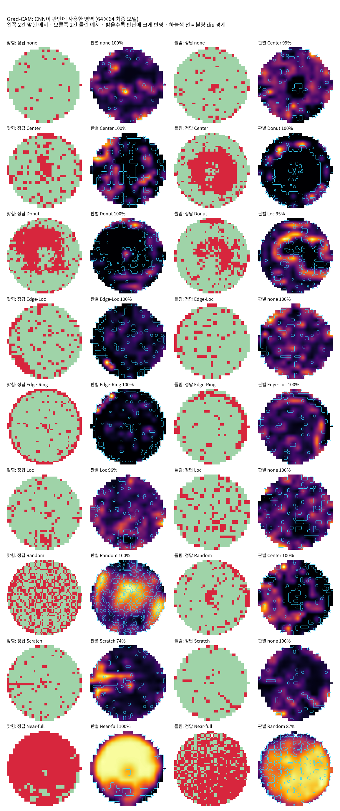
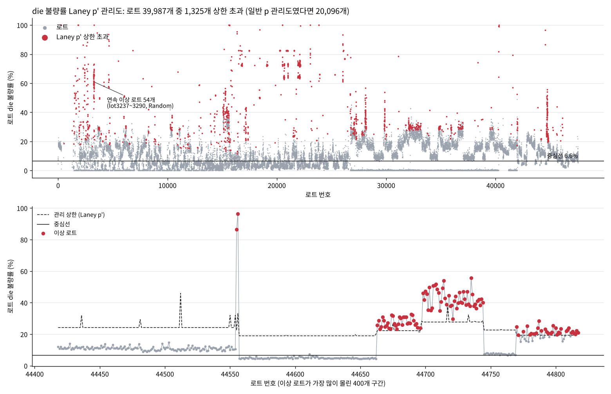
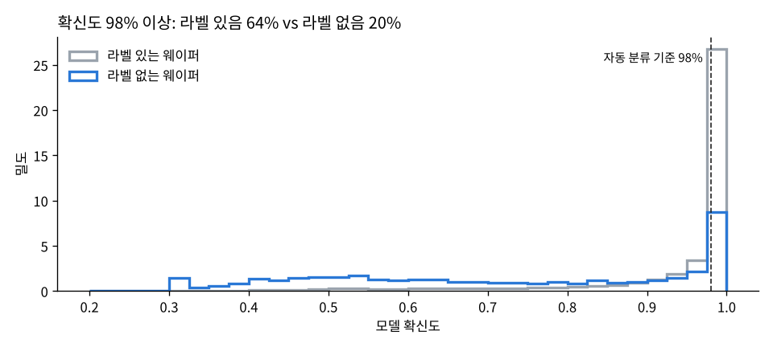
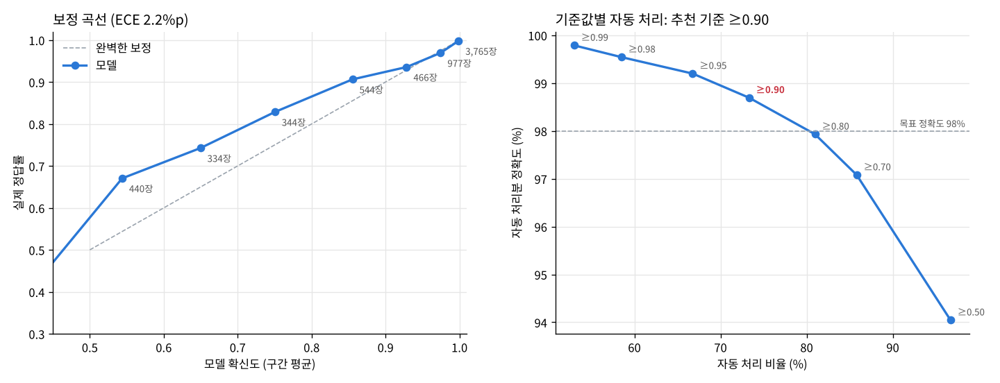

# 웨이퍼 맵 불량 패턴 판별과 로트 단위 이상 감지

실제 반도체 생산 라인의 웨이퍼 맵 공개 데이터(WM-811K)로 CNN을 학습해 불량 패턴 9종을 판별하고, 81만 장 전체를 로트 단위로 묶어 SPC 관리도로 이상 로트를 찾은 프로젝트입니다. 수율 엔지니어가 하는 일(패턴 분류 → 판단 근거 확인 → 로트 감시 → 자동/검토 분류 운영)을 공개 데이터로 축소해 구현했습니다.

**[판별 앱 열기](https://kevezk.github.io/wafer-defect-cnn/)** · [노트북](notebooks/wafer_cnn.ipynb) · [면접 대비 자료](PORTFOLIO.md)



## 핵심 결과

| 항목 | 결과 |
|---|---|
| 불량 패턴 분류 (평가 웨이퍼 7,104장) | 정확도 **92.4%**, Macro F1 **0.894** (기본 모델 88.2%, 0.79) |
| 가장 어려운 패턴 Scratch | 정답률 4% → 45% → **81%** (증강 → 해상도 → 앙상블) |
| 로트 단위 이상 감지 (811,457장, 로트 39,987개) | Laney p' 관리도로 이상 로트 **1,325개(3.3%)** 검출. 일반 p 관리도는 50%를 잘못 경보 |
| 자동/검토 분류 | 확률 90% 이상만 자동 처리 시 **73%**를 정확도 **98.7%**로 처리, 오분류의 **87%**는 검토로 분리 |

### 개선 단계별 성능

| 모델 | 정확도 | Macro F1 | Scratch | Loc | Donut |
|---|---|---|---|---|---|
| 32×32, 증강 전 | 88.2% | 0.792 | 4% | 77% | 80% |
| 32×32, 소수 패턴 증강 | 87.6% | 0.819 | 36% | 57% | 93% |
| 64×64, 증강 | 90.8% | 0.851 | 45% | 74% | 95% |
| 64×64, 깊은 모델 | 89.1% | 0.855 | 88% | 60% | 72% |
| **최종: 64×64 기본 + 깊은 모델 앙상블** | **92.4%** | **0.894** | **81%** | **70%** | **95%** |

## 무엇을 했나

### 1. 데이터와 전처리
- WM-811K: 실제 생산 라인 웨이퍼 맵 811,457장 중 전문가가 패턴을 붙인 172,950장 사용. 85%가 none(패턴 없음)이고 가장 적은 Near-full은 149장
- 맵 크기가 346가지라 64×64로 통일(최근접 보간, 0/1/2 값 유지), none은 1만 장만 사용, 패턴 비율을 유지해 학습:평가 = 8:2
- 2,000장 미만 패턴은 회전·뒤집기로 증강 (웨이퍼는 원형이라 회전해도 패턴 의미 유지)

### 2. 판단 근거 확인 (Grad-CAM)
Scratch는 긁힘 선, Edge 계열은 가장자리 불량을 보고 판단해 공정 관점에서 타당했습니다. 반면 기본 모델은 Center를 불량 덩어리보다 주변의 깨끗한 영역으로 구분했습니다(불량 집중도 0.65).



### 3. 로트 단위 SPC
- 주 지표는 **로트 die 불량률**(측정값, 모델과 무관). 로트당 die가 수만 개라 일반 p 관리도는 한계가 너무 좁아 로트의 50%를 이상으로 잡음 → **Laney p' 관리도**로 로트 간 변동을 반영
- 가장 긴 이상 구간: lot3237~3290의 연속 54개 로트(die 불량률 61%, 주로 Random)
- die 불량률 관리도는 Near-full·Random 같은 전면 불량은 잘 잡지만 Scratch·Loc 같은 국소 패턴은 거의 못 잡음 → 패턴 분류가 관리도를 보완해야 하는 이유



### 4. 모델을 그대로 믿으면 안 되는 경우
라벨 없는 웨이퍼 63만 장에 모델을 적용하자 45%를 불량 패턴으로, 23%를 Scratch로 판별했습니다. 이 웨이퍼들은 불량률 분포가 다르고(중앙값 5.3% vs 10.6%) 확신도 98% 이상 비율도 20%(라벨 있는 웨이퍼 64%)에 그쳤습니다. 그래서 관리도는 측정값으로 그리고, 모델 판별은 확신도가 높을 때만 썼습니다. 학습 때 못 본 특이한 칩 배치(lot26217)는 확신도 98% 이상으로도 틀렸습니다.



### 5. 자동/검토 분류 설계
보정 곡선으로 확률과 실제 정답률을 비교하고, 기준값별 자동 처리 비율과 정확도를 계산해 운영 기준을 정했습니다. 추천 기준(90%)에서 Scratch는 86%, Loc은 69%가 검토로 넘어가고 Edge-Ring은 5%만 넘어갑니다.



### 6. Scratch 개선 실험
| 방법 | 결과 |
|---|---|
| 불량 보존 축소 (축소 시 불량 die를 지우지 않음) | 효과 없음 (45% → 46%). 해상도가 주원인이 아님을 확인 |
| 깊은 모델 (합성곱 8층 + 배치 정규화) | Scratch 88%로 크게 개선, 대신 none·Donut 하락, 학습 불안정 |
| 기본 + 깊은 모델 앙상블 | 강점이 다른 두 모델의 평균으로 전체 최고 성능 → 최종 모델 |

## 실행 방법

1. Kaggle에서 WM-811K 데이터셋(`LSWMD.pkl`, 압축 약 150MB)을 내려받습니다. 원본 데이터는 이 저장소에 포함하지 않았습니다.
2. [Google Colab](https://colab.research.google.com)에서 `notebooks/wafer_cnn.ipynb`를 열고 **런타임 → 런타임 유형 변경 → GPU**를 고릅니다.
3. **모두 실행** 후 첫 칸의 업로드 버튼으로 zip을 올리면 ①~⑬ 단계가 순서대로 실행됩니다. CPU만으로는 전체 약 1시간 30분, GPU면 훨씬 짧습니다. 같은 코드라도 실행 환경(특히 GPU)에 따라 수치가 조금 달라질 수 있습니다.

학습된 모델만 쓰려면:

```python
import torch
base = WaferCNN(s=64); base.load_state_dict(torch.load('models/wafer_cnn_base64.pt'))   # 노트북 ④의 구조
deep = DeepCNN(s=64);  deep.load_state_dict(torch.load('models/wafer_cnn_deep64.pt'))  # 노트북 ⑫의 구조
# 최종 판별 = 두 모델 softmax 확률의 평균
```

## 저장소 구조

```
index.html          판별 앱 (GitHub Pages로 공개, 모델이 브라우저에서 직접 계산)
notebooks/          Colab에서 처음부터 끝까지 재현하는 노트북
models/             학습된 모델 가중치 (64×64 기본, 64×64 깊은 모델)
src/                실제 실행한 파이프라인 스크립트 (전처리, 학습, Grad-CAM, 로트 SPC, 보정, 앱 빌드)
results/            모델별 성능, 보정, 로트 SPC 결과 (JSON)
figures/            보고서·README 그림
PORTFOLIO.md        이력서용 설명과 면접 예상 질문
```

## 내 역할과 AI 활용

이 프로젝트는 생성형 AI(Claude)를 써서 프롬프트 10회 안에 만들었습니다. 코드 작성과 실행은 AI가 했고, 저는 다음을 맡았습니다.
- 주제와 데이터 선정: 합성 데이터 대신 실제 공정 데이터(WM-811K)를 쓰기로 결정
- 단계 설계: 패턴 분류에서 끝내지 않고 Grad-CAM, 로트 SPC, 자동/검토 분류까지 수율 관리 흐름으로 확장
- 결과 검토: 처음 만든 로트 관리도가 모델 오류로 채워진 것을 확인하고 측정값 기반으로 바꾸는 판단, 해상도 비교와 개선 실험 방향 결정

## 한계

- 라벨은 패턴만 알려 주고 공정·장비 정보가 없어, 의심 공정은 일반 지식으로 연결했습니다.
- 웨이퍼당 라벨이 하나라 패턴이 섞인 웨이퍼를 표현하지 못합니다.
- 칩 크기가 다른 제품이 섞여 있는데 관리도를 하나로 그렸고, 로트 번호가 실제 시간 순서인지 알 수 없습니다.
- 앙상블은 평가 데이터 결과를 보고 골라 수치가 조금 낙관적일 수 있습니다. 로트 분석의 패턴 판별은 64×64 기본 모델로 했습니다.
- 2015년 공개 데이터라 최신 공정과 차이가 있을 수 있습니다.

## 참고

- M.-J. Wu, J.-S. R. Jang, J.-L. Chen, "Wafer Map Failure Pattern Recognition and Similarity Ranking for Large-Scale Data Sets," *IEEE Transactions on Semiconductor Manufacturing*, 28(1), 1–12, 2015.
- D. B. Laney, "Improved control charts for attributes," *Quality Engineering*, 14(4), 531–537, 2002.
- R. R. Selvaraju et al., "Grad-CAM: Visual Explanations from Deep Networks via Gradient-based Localization," *ICCV*, 2017.
